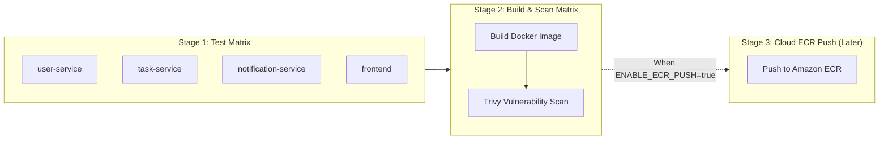

# CI/CD Pipeline Documentation

This directory contains the GitHub Actions workflow for the Task Management microservice platform.

---

## 📋 Workflow Overview (`.github/workflows/ci.yaml`)

The pipeline runs across two parallel matrix stages whenever code is pushed or a PR is opened targeting `main` or `master`:



---

## 🛠️ Current Behavior ("For Now")

1. **Unit Testing Matrix**: Installs Node 22 dependencies and runs `npm test` on each of the 4 microservices in parallel.
2. **Docker Build**: Builds production container images using `docker/build-push-action` with GitHub Actions layer caching.
3. **Security Vulnerability Scanning**: Aqua Security **Trivy** scans each container for OS and library CVEs (`HIGH` and `CRITICAL`), printing a security report in the GitHub Actions console.

---

## ☁️ Activating the Amazon ECR Push ("Later")

When your AWS ECR infrastructure is ready (e.g., after provisioning with Terraform), you can activate the ECR push step in one of two ways:

### Option A: Manual Trigger via GitHub UI
Go to **Actions** &rarr; **CI - Build, Test & Containerize Microservices** &rarr; **Run workflow** &rarr; check **"Push images to Amazon ECR?"**.

### Option B: Permanent Automatic Push on Every Commit
In [ci.yaml](file:///Users/partha/Downloads/devops_project/.github/workflows/ci.yaml#L26), set:
```yaml
env:
  ENABLE_ECR_PUSH: true
```

### Required GitHub Repository Secrets:
Under **GitHub Repository Settings** &rarr; **Secrets and variables** &rarr; **Actions**:
- `AWS_ACCESS_KEY_ID`: IAM access key with `ecr:GetAuthorizationToken`, `ecr:BatchCheckLayerAvailability`, `ecr:PutImage`, `ecr:InitiateLayerUpload`, `ecr:UploadLayerPart`, `ecr:CompleteLayerUpload`.
- `AWS_SECRET_ACCESS_KEY`: IAM secret key.
- (Or configure OIDC `AWS_ROLE_ARN` for keyless authentication).
